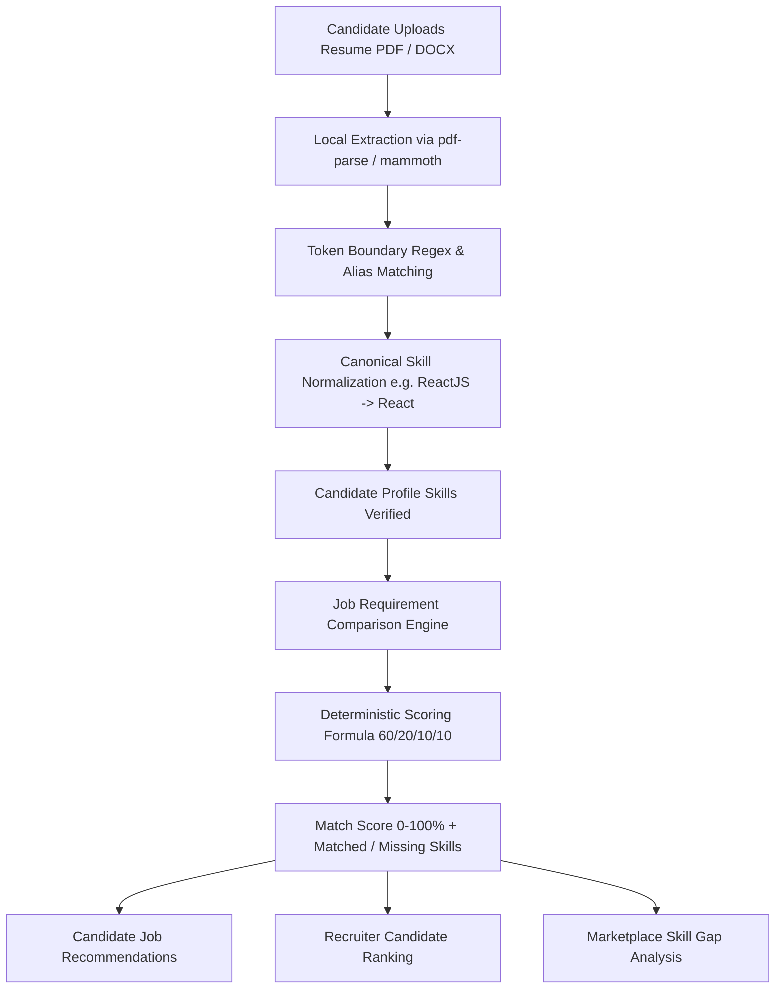

# SmartHire: Smart Job Portal with Resume Matching

> **A Production-Grade MERN Stack Recruitment Marketplace with Local, Explainable, Deterministic Resume-Job Matching.**  
> *Developed for BE CSE Final Year Project / Technical Demonstration.*

---

## 1. Executive Summary

Traditional applicant tracking systems (ATS) often operate as opaque "black-boxes" or rely on costly third-party AI APIs (OpenAI, Gemini) that are non-deterministic, expensive, and difficult to defend during viva examinations.

**SmartHire** solves this by introducing a **100% locally executable, deterministic, and explainable rule-based matching engine**. The platform allows candidates to upload resumes (PDF or DOCX), automatically parses unstructured text using local npm libraries (`pdf-parse`, `mammoth`), normalizes skills against a centralized 70+ skill taxonomy, and evaluates compatibility against job requirements across four weighted dimensions: **Skills (60%)**, **Experience (20%)**, **Education (10%)**, and **Certifications (10%)**.

Employers receive automated, ranked candidate shortlists with complete visual explanations of matched and missing skills, while candidates gain access to personalized job recommendations and aggregate **Skill Gap Analyses**.

---

## 2. Core Differentiating Workflow



---

## 3. Technology Stack

### Frontend
- **Framework**: React 18 (Single Page Application via Vite)
- **Styling**: Tailwind CSS (Clean, modern glassmorphic theme with responsive drawer sidebar)
- **Icons**: Lucide React
- **Visualizations**: Recharts (Market demand bar charts, match score donuts, status distribution)
- **Routing**: React Router DOM v6 with role-aware `ProtectedRoute` guards
- **HTTP Client**: Axios with JWT Bearer request/response interceptors

### Backend
- **Runtime**: Node.js v24
- **Framework**: Express.js REST API
- **Database**: MongoDB with Mongoose ODM (Indexes, compound unique constraints)
- **Authentication**: JWT (JSON Web Tokens) with `bcryptjs` password hashing (10 salt rounds)
- **File Uploads**: Multer with strict MIME validation (PDF and DOCX up to 5MB)
- **Local Parsing**: `pdf-parse` (PDF stream parsing) and `mammoth` (DOCX raw text extraction)
- **Zero Paid APIs**: Absolutely no OpenAI, Gemini, or third-party cloud API dependencies

---

## 4. The Deterministic Matching Engine

The core scoring engine is implemented in `server/services/matchingService.js` and evaluates every candidate-job pair using an explainable mathematical formula:

$$\text{OverallScore} = (\text{SkillScore} \times 0.60) + (\text{ExperienceScore} \times 0.20) + (\text{EducationScore} \times 0.10) + (\text{CertificationScore} \times 0.10)$$

### Component Breakdown:

1. **Skill Score (60% Weight)**:
   - Candidate skills (profile + parsed resume) and job skills are canonicalized via `skillDictionary.js`.
   - $\text{Coverage} = \frac{|\text{CandidateSkills} \cap \text{JobRequiredSkills}|}{|\text{JobRequiredSkills}|} \times 100$.
   - Matched preferred skills provide an additional bonus of up to 10 points (capped at 100).
2. **Experience Score (20% Weight)**:
   - If candidate experience $\ge$ required experience: $100\%$.
   - If candidate experience $<$ required experience: $\frac{\text{candidateYears}}{\text{requiredYears}} \times 100$.
3. **Education Match (10% Weight)**:
   - Compares candidate degree tiers (Ph.D., Master's, Bachelor's, Diploma) against job prerequisites.
4. **Certification Match (10% Weight)**:
   - Assesses industry credentials (AWS, Oracle, Docker, etc.) and keyword overlap.
5. **Output**:
   - Strictly bounded between **0 and 100%**.
   - Generates exact arrays for `matchedSkills`, `missingSkills`, and `preferredSkillsMatched`.

---

## 5. User Roles & Capabilities

| Role | Key Features |
| :--- | :--- |
| **Job Seeker (Candidate)** | Register/Login, Profile builder, Resume upload (PDF/DOCX), Extracted skills reviewer, Live match breakdown per job, 1-Click apply, Application status tracker with history timeline, Job recommendations, Skill gap analysis, Scheduled interviews, In-app notifications. |
| **Employer (Recruiter)** | Register/Login, Company profile builder, Job posting (with required & preferred skill tags), Manage listings, **Automated Candidate Ranking** (descending by match score), Filter candidates by score and status, Inspect candidate resumes, Advance status (Shortlist/Select/Reject), Schedule interviews with meeting links. |
| **Platform Administrator** | System command center, Real MongoDB aggregation telemetry, User account activation/deactivation, Company approval/rejection moderation, Job publication moderation, System-wide application telemetry. |

---

## 6. Project Directory Structure

```
smartHire/
├── client/                      # Vite + React 18 + Tailwind CSS frontend
│   ├── src/
│   │   ├── components/
│   │   │   ├── common/          # Navbar, Sidebar, Footer, ProtectedRoute, Modal, SkillChip
│   │   │   └── matching/        # MatchScoreBadge, MatchBreakdownCard, SkillGapChart
│   │   ├── context/             # AuthContext (JWT session), NotificationContext
│   │   ├── layouts/             # MainLayout (Public), DashboardLayout (Role-based)
│   │   ├── pages/
│   │   │   ├── public/          # LandingPage, LoginPage, RegisterPage, PublicJobsPage, JobDetailsPage, AboutPage
│   │   │   ├── candidate/       # CandidateDashboard, ProfilePage, ResumeUploadPage, RecommendedJobs, Applications, SkillGap, Interviews
│   │   │   ├── employer/        # EmployerDashboard, CompanyProfile, ManageJobs, CreateJob, EditJob, JobApplicants, Interviews, Analytics
│   │   │   ├── admin/           # AdminDashboard, AdminUsers, AdminCompanies, AdminJobs, AdminApplications
│   │   │   └── common/          # NotificationsPage, SettingsPage, NotFoundPage
│   │   ├── services/            # Axios instance with JWT interceptors
│   │   ├── utils/               # Constants and status badge maps
│   │   ├── App.jsx              # React Router v6 route hierarchy
│   │   ├── main.jsx
│   │   └── index.css            # Tailwind directives
│   ├── package.json
│   ├── tailwind.config.js
│   └── vite.config.js
│
├── server/                      # Node.js + Express.js + MongoDB API
│   ├── config/
│   │   └── db.js                # MongoDB Mongoose connection
│   ├── controllers/             # Auth, User, Company, Job, Resume, Application, Matching, Interview, Notification, Admin
│   ├── middleware/              # Auth (JWT & Roles), Upload (Multer 5MB PDF/DOCX), ErrorHandler
│   ├── models/                  # User, Company, Job, Resume, Application, Interview, Notification, Skill
│   ├── routes/                  # RESTful API route modules
│   ├── seed/
│   │   ├── seedData.js          # Realistic Indian tech talent and company seed data
│   │   └── seeder.js            # Automated database seeder runner
│   ├── services/
│   │   ├── skillDictionary.js   # 70+ Canonical skills with alias mapping
│   │   ├── skillExtractor.js    # Regex word-boundary text extraction & normalization
│   │   ├── resumeParser.js      # Local PDF and DOCX file parser
│   │   └── matchingService.js   # Deterministic 60/20/10/10 scoring engine
│   ├── utils/
│   │   └── testE2E.js           # Automated 13-point integration test suite
│   ├── uploads/                 # Storage for candidate resume uploads
│   ├── app.js                   # Express application setup & route mounting
│   ├── server.js                # Server entry point
│   └── package.json
│
├── .env.example
├── .gitignore
├── package.json                 # Root script runner (concurrent client & server)
└── README.md                    # Project documentation & viva defense guide
```

---

## 7. Fictional Demo Accounts for Testing & Viva

The login page (`/login`) includes **One-Click Quick Fill buttons** to immediately test any account without manual typing:

| Role | Email | Password | Persona & Expected Match Behavior |
| :--- | :--- | :--- | :--- |
| **Admin** | `admin@smarthire.com` | `Admin@123` | Platform Administrator with full telemetry & moderation. |
| **Employer** | `hr@techcorp.com` | `Employer@123` | TechCorp HR recruiter. Views candidate rankings for MERN roles. |
| **Candidate** | `rahul.sharma@example.com` | `Candidate@123` | **MERN Expert** (3.5 yrs exp). Yields **95%+ Match** on Senior MERN Stack Developer. |
| **Candidate** | `priya.patel@example.com` | `Candidate@123` | **Frontend Specialist** (React, Next.js, TypeScript). Yields **95% Match** on Frontend React role. |
| **Candidate** | `arun.kumar@example.com` | `Candidate@123` | **Backend & DevOps Engineer** (Node, Docker, AWS). Yields **92% Match** on Backend Engineer role. |
| **Candidate** | `vikram.verma@example.com` | `Candidate@123` | **Fresher** (0.5 yr exp). Yields **85% Match** on Associate Web Dev, but **~40% Low Match** on Senior MERN (perfect for viva contrast). |

---

## 8. Installation & Setup Instructions

### Prerequisites
- **Node.js** (v18 or higher recommended)
- **MongoDB** (Local instance running on `mongodb://127.0.0.1:27017` or MongoDB Atlas URI)

### Quick Start (3 Steps)

1. **Install Dependencies**:
   ```bash
   # From the project root:
   npm run install:all
   ```

2. **Seed the Database**:
   ```bash
   npm run seed
   ```
   *This seeds 70 skills, 10 users, 5 companies, 10 jobs, candidate resumes, and sample applications.*

3. **Start the Application**:
   ```bash
   # Run both server (port 5000) and client (port 5173) concurrently:
   npm run dev
   ```

   - **Frontend UI**: [http://localhost:5173](http://localhost:5173)
   - **Backend API**: [http://localhost:5000/api/health](http://localhost:5000/api/health)

---

## 9. API Reference

### Authentication
- `POST /api/auth/register` — Register Candidate or Employer
- `POST /api/auth/login` — Sign in and receive JWT token
- `GET /api/auth/me` — Retrieve current authenticated profile
- `PUT /api/auth/updatepassword` — Update user password

### Resume & Skill Extraction
- `POST /api/resumes/upload` — Upload PDF/DOCX (Multer), extracts text & detected skills locally
- `GET /api/resumes/my` — Retrieve candidate's active parsed resume
- `PUT /api/resumes/skills` — Refine/edit extracted skills
- `DELETE /api/resumes/my` — Remove uploaded resume

### Deterministic Matching Engine
- `GET /api/matching/job/:jobId` — Instant live match score & skill breakdown for candidate
- `GET /api/matching/candidates/:jobId` — Ranked candidate applicants for recruiter (descending by score)
- `GET /api/matching/recommendations` — Candidate personalized job recommendations
- `GET /api/matching/skill-gap` — Aggregate skill gap analysis against active marketplace jobs

### Jobs & Applications
- `GET /api/jobs` — Search jobs by keyword, location, workMode, jobType, experience
- `POST /api/jobs` — Create job listing (Employer)
- `POST /api/applications` — Submit job application with live score snapshot
- `GET /api/applications/my` — Candidate application tracking table
- `PUT /api/applications/:id/status` — Recruiter advances candidate status (Shortlisted, Rejected, etc.)

### Interviews & Notifications
- `POST /api/interviews` — Schedule candidate interview with Google Meet link
- `GET /api/interviews` — Retrieve scheduled interviews for current user
- `GET /api/notifications` — In-app notification alerts
- `PUT /api/notifications/read-all` — Mark notifications read

### Admin Moderation
- `GET /api/admin/dashboard` — Platform KPIs & MongoDB aggregation telemetry
- `GET /api/admin/users` — User account management (activate/deactivate)
- `PUT /api/admin/companies/:id/status` — Approve or reject employer companies

---

## 10. College Viva & Technical Defense Guide

### Q1: Why use a deterministic rule-based matching algorithm instead of an LLM or OpenAI API?
> **Answer**: 
> 1. **Explainability & Fairness**: Recruitment platforms require transparent compliance. If an applicant is rejected, we can explicitly show that *Docker* and *AWS* were missing from their required skills.
> 2. **Reliability & Consistency**: LLMs can hallucinate and give different match percentages for the identical resume submitted twice. Our mathematical formula guarantees that the score is always reproducible.
> 3. **Zero Cost & Offline Execution**: The system runs entirely locally on standard Node.js without external token billing, rate limits, or network downtime.

### Q2: How are variations of skills handled (e.g. `ReactJS` vs `React`)?
> **Answer**: 
> We utilize a centralized taxonomy in `server/services/skillDictionary.js` mapping aliases (`['reactjs', 'react.js', 'react js']`) to canonical forms (`React`). During parsing and before matching, all terms are converted to their canonical representation.

### Q3: How do you prevent duplicate applications?
> **Answer**: 
> In `server/models/Application.js`, we enforce a MongoDB compound unique index: `applicationSchema.index({ candidate: 1, job: 1 }, { unique: true })`. Attempting to apply again immediately triggers a duplicate key error handled gracefully by the centralized error middleware.

---

## 11. Verification & Automated Tests

To run the automated 13-point integration test suite:
```bash
cd server
node utils/testE2E.js
```
*Tests authentication, live matching, recommendations, ranking, status progressions, interview dispatching, and admin telemetry.*
